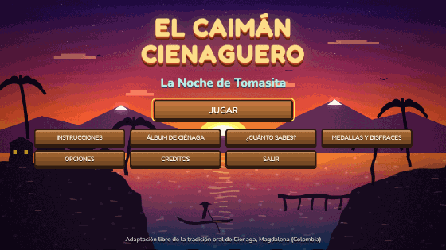

# El Caimán Cienaguero: La Noche de Tomasita

Videojuego 2D narrativo con vista superior (top-down), hecho con HTML5 Canvas, CSS3 y JavaScript ES6+, con una capa de efectos en WebGL (PixiJS) y animaciones de interfaz con GSAP.
Está inspirado en la tradición oral del Caimán Cienaguero de Ciénaga, Magdalena (Colombia).

> Mateo, su abuelo y el viaje al pasado son personajes y situaciones ficticias. El juego es una
> adaptación libre de la tradición oral, no una reconstrucción histórica exacta.



**Jugar en línea:** https://jesuspriv.github.io/caiman-cienaguero/ (si GitHub Pages está activado).

## Cómo ejecutarlo

- Abre `index.html` con doble clic en cualquier navegador moderno (Chrome, Edge o Firefox).
- No hace falta instalar nada ni usar un servidor. Los scripts son clásicos, no módulos, así que funcionan desde `file://`.
- PixiJS, pixi-filters y GSAP vienen incluidas en `js/lib/`, así que no necesitan internet. Si el navegador no tiene WebGL, el juego se ve con los gráficos clásicos.
- En la fiesta suena la música de la danza del Caimán Cienaguero desde `audio/danza-caiman.mp3`. Si ese archivo no está, se usa el video de YouTube (necesita internet y un servidor como Live Server), y si tampoco, la cumbia original del juego.
- **En celular**: se juega con el teléfono acostado (si está vertical, el juego pide girarlo). Al tocar la pantalla de carga se pone en pantalla completa. Hay cruceta, botón E y botón CORRER; se ocultan durante los diálogos, y en el desfile, el baile y los versos se juega tocando la pantalla.
- Las fuentes (Fredoka y Nunito) se cargan desde Google Fonts. Sin internet, el juego funciona igual con una fuente de respaldo.

## Controles

| Acción | Teclado | Táctil |
|---|---|---|
| Moverse | W A S D / Flechas | Cruceta |
| Correr | Shift (mantener) | Botón CORRER (se activa y desactiva) |
| Interactuar / continuar diálogo | E (también Enter o Espacio) | Botón E |
| Adelantar diálogos y cinemáticas | Mantener E | Mantener el botón E |
| Mapa | Q o TAB | Botón MAPA |
| Pausa | ESC | Botón II |
| Silenciar | M | Menú de pausa |

## Escenas

0. **Menú principal**: Ciénaga al atardecer, con la Sierra Nevada al fondo.
1. **Casa del abuelo**: diálogo inicial y la figura de caimán tallada en madera.
2. **Ciénaga del pasado**: plaza, templete, casas de colores y tres habitantes.
3. **Búsqueda de pistas**: una flor de cayena, una vela y una cinta.
4. **Puerto Cachimbero**: de noche, con muelles, canoas, caños y agua peligrosa.
5. **Encuentro con el caimán**: patrulla, detección, persecución y regreso a su zona.
6. **La historia de Tomasita**: cinemática narrada, sin violencia gráfica.
7. **La tradición**: tambores, bailadores, figuras de caimán y fuegos artificiales.
8. **Regreso al presente**: conversación con el abuelo en casa.
9. **Epílogo: el Festival de hoy**: Mateo y el abuelo recorren el festival de día; la conversación final lleva a la pantalla de victoria (y al final secreto si lo completaste todo).

## Sistemas implementados

- **Misiones**: 9 misiones lineales. Solo avanza la misión actual, así que no se pueden saltar etapas.
- **Puntuación**: hablar con un NPC da +10 (solo la primera vez), una pista +20, una figurita +15, una misión completada +50 y terminar el juego +100.
- **Vidas**: empiezas con 3. El agua y el caimán quitan una vida, con parpadeo, retroceso y 2 s de invulnerabilidad. Al perderlas todas aparece GAME OVER con un botón para reintentar desde el inicio de la escena.
- **Diálogos**: caja inferior reutilizable con retrato, nombre, texto que aparece letra por letra e indicador `[E] CONTINUAR`. Al mantener E, el tiempo corre 4 veces más rápido y aparece `▶▶ ADELANTANDO`.
- **Retratos con emociones**: los personajes cambian de cara según la línea (feliz, triste con lágrima, sorprendido, asustado o preocupado con gota de sudor), y el marco del retrato reacciona. La emoción se marca en cada línea con `mood` o se deduce del texto (¿…? o ¡…!).
- **Títulos de capítulo**: al entrar a cada escena aparece una tarjeta (Capítulo 1 al 4 y Epílogo) con la figura de caimán tallada.
- **Correr y globitos**: Mateo corre con Shift (1,6 veces más rápido). Sobre las cabezas aparecen globitos: ♪ en los bailarines, un saludo de quien ya habló contigo, un `!` rojo cuando el caimán te detecta, y Mateo silba o espera si se queda quieto.
- **Sonido ambiente**: cada escena tiene su ambiente sintetizado: en el pueblo, brisa, murmullo, pájaros, marías mulatas, campanas de la iglesia y un perro a lo lejos (de noche cambian por grillos); en el puerto, olas, ranas y grillos; en la fiesta, el bullicio de la gente; en la casa, el tictac del reloj. Los pasos de Mateo suenan distinto en pasto, tierra, baldosa, arena y madera.
- **Vida en el escenario**: las palmeras se mecen con la brisa. En el pueblo hay gallinas que picotean y huyen si corres cerca, marías mulatas (el pájaro negro típico de la región) que vuelan al acercarte y un perro criollo que ladra, se deja acariciar (+5 la primera vez) y luego te sigue. En el puerto hay garzas en la orilla, y en la fiesta, marías mulatas junto a las mesas de comida.
- **El tiempo pasa en el pueblo**: empieza de tarde y oscurece a medida que hablas con los habitantes y encuentras las pistas, hasta llegar a la noche. Cambian la luz, los colores y los sonidos, y un indicador muestra si es TARDE, ATARDECER o ANOCHECER.
- **Mapa** (Q, TAB o botón MAPA): el escenario en miniatura con niebla en las zonas que aún no visitas, los lugares importantes, quién falta por conocer (!), las pistas encontradas (✓), el objetivo (★) y tu posición. El juego se detiene mientras lo miras.
- **Minijuego del verseador** (escena 7): después de hablar con él, te reta. Canta tres versos y tú eliges la palabra que rima para completar el cuarto (5 rondas, 14 s cada una). Cada rima vale +10 la primera vez; después puedes repetirlo para mejorar el récord. Los versos son originales, escritos para el juego.
- **Conocer a Tomasita**: al llegar al pueblo, Tomasita y Juanita juegan en la plaza. Tomasita se presenta, invita a Mateo a jugar a la lleva (20 s para alcanzarla, +20) y luego se van hacia el puerto. Cuenta para la misión «Conoce a la gente del pueblo».
- **Pistas con retos**: la flor está en el jardín de doña Carmen y hay que pedirle permiso; la vela está apagada y hay que encenderla en un farol; la cinta está enredada en una palmera y el niño del pueblo trepa a bajarla. La flecha de objetivo guía cada paso.
- **Misiones secundarias** (pueblo): los cocos de la vendedora (3 cocos bajo las palmeras, +30) y la atarraya perdida del pescador (+30). Se activan al hablar con ellos por segunda vez y aparecen en el mapa (◆).
- **Sigilo en el puerto**: entre los juncales altos Mateo queda escondido y el caimán no lo ve (si ya lo perseguía, lo pierde). Correr hace ruido y lo atrae desde más lejos, y cerca de una antorcha el caimán se retira porque le teme al fuego.
- **Minijuego de la canoa** (escena 6): tras la historia de Tomasita, Mateo acompaña a los pescadores en la búsqueda. Con ◀ ▶ se esquivan troncos, raíces de mangle y al caimán, y se recogen velas flotantes (+5 cada una, −5 por golpe).
- **Minijuego de baile** (escena 7): después de hablar con la bailadora, ella muestra pasos de cumbia y Mateo los repite con las flechas; cada ronda suma un paso (5 rondas, 3 vidas, +10 por ronda la primera vez).
- **Final secreto**: con las 6 figuritas, las 2 misiones secundarias y los retos del verseador y del baile, el abuelo le regala a Mateo la figura de caimán tallada. Desbloquea la tarjeta 13 del álbum, «El regalo del abuelo», y +100.
- **Guardar partida**: el juego se guarda solo (al empezar cada escena, al completar misiones y cada 15 s de juego libre). En el menú aparece **CONTINUAR** con el capítulo donde ibas. Al terminar la historia, la partida guardada se borra.
- **¿Cuánto sabes de Ciénaga?**: quiz de 8 preguntas al azar (de 18) con datos reales del juego y del álbum. Después de cada respuesta explica el dato, así también enseña. Guarda tu récord. Está en el menú principal y en la pantalla de victoria.
- **¿Sabías que...?**: cada título de capítulo muestra un dato real sobre Ciénaga y su tradición.
- **Dificultad** (en Opciones): FÁCIL (NIÑOS), con agua sin daño, caimán más lento y más tiempo en los retos; NORMAL; y DIFÍCIL.
- **Tutorial**: consejos en pantalla para caminar, hablar, correr y usar el mapa (con textos distintos en pantallas táctiles).
- **Medallas y disfraces**: 17 medallas por explorar, aprender y jugar bien (encontrar las pistas, probar los 7 sabores, aprender las 12 palabras, cruzar el puerto sin perder vidas, ritmo perfecto en el tambor, terminar el desfile…). Seis de ellas desbloquean un disfraz para Mateo: cumbiambero, pescador, raspadero, guía con guayabera, vueltiao de colores y máscara de caimán. El disfraz se ve en el pueblo, en los retratos y en los minijuegos. Todo se guarda en el navegador.
- **El Desfile del Caimán**: en la fiesta, el portador del caimán te invita a cargarlo en la Gran Parada. Cambias de carril con las flechas para esquivar charcos, un perro dormido y carretillas de cocos, y recoges notas y flores de cayena hasta llegar al templete, con la canción de la danza sonando.
- **Pantalla de carga**: un caimán desfilando, la barra de progreso y datos reales de Ciénaga mientras cargan las letras, los efectos y la canción. Al final pide tocar la pantalla, lo que también permite que suene la música.
- **Créditos**: pantalla con el proyecto, la historia, la música, las tipografías y los autores y licencias de cada foto del álbum.
- **Opciones**: volumen de música y de efectos, velocidad del texto (lento, normal, rápido o instantáneo), temblor y destellos (se pueden quitar para mayor comodidad) y flecha de objetivo. Se guardan en el navegador.
- **HUD**: vidas, puntos, misión actual con su pista, pistas encontradas, figuritas e indicador de interacción.
- **Gráficos**: todo se dibuja por código en estilo ilustrado (formas vectoriales con sombreado, contornos y caras expresivas). El canvas se dibuja a la resolución real de la pantalla, cada escena tiene su propio tono de color y hay rayos de luz y brillos. La carpeta `assets/` está reservada y no se necesita. La versión anterior en pixel art está en `../caiman-cienaguero-pixel-backup`.
- **Sonido**: música y efectos sintetizados con Web Audio API. La música es una **cumbia cienaguera original** (melodías y arreglos compuestos para el juego, sin usar canciones protegidas). Tiene tambora, llamador, tambor alegre, guacharaca, maracas, bajo, acordeón de acompañamiento, caña de millo y gaita, con reverberación de plaza. El pueblo suena en Sol mayor a 94 BPM y la fiesta en Re mayor a 116 BPM; en el puerto se oye la fiesta a lo lejos. El minijuego del tambor usa la misma cumbia de la fiesta, y el jugador toca el tambor alegre encima.
- **Flecha de objetivo**: una flecha dorada en el borde de la pantalla apunta a la siguiente meta. Cuando la meta está a la vista, un marcador rebota encima de ella.
- **Avisos del caimán**: cerca del caimán aparecen burbujas y se oye un latido que se acelera. Antes de lanzarse se hunde, burbujea, muestra un `!` y se ilumina durante 1,2 s. Solo hace daño cuando ya está persiguiendo. Al recibir un golpe hay temblor de pantalla, un destello rojo y una pausa breve, y el borde de la pantalla se tiñe de rojo mientras te persigue.
- **Minijuego del tambor alegre** (escena 7): presiona E cuando cada parche llega al tambor, al ritmo del llamador, las maracas y la gaita. Para volver al presente hay que tocarlo. El ritmo da un bono de hasta +50 la primera vez, y luego se puede repetir para mejorar el récord.
- **Álbum de Ciénaga**: 38 tarjetas con datos reales, en cuatro pestañas: HISTORIA (13: pistas, figuritas, la historia de Tomasita, el tambor y el final), LUGARES (6: al mirar el templete, la iglesia, el palacio, la Casa del Diablo, el Palacio Azul y la estación), SABORES (7: al probar la comida típica) y PALABRAS (12: al oír palabras costeñas en los diálogos). Se guardan en el navegador (localStorage) entre partidas y se consultan en el menú, en la pausa o en la pantalla de victoria.

## Datos reales usados

El juego toma estos elementos de la tradición y de la ciudad. La leyenda es tradición oral, así que tiene varias versiones.

- La fecha: el 20 de enero, día de San Sebastián, en el Puerto Cachimbero (una ensenada junto a la ciénaga). Tomasita era hija de pescadores. Después del ataque, los pescadores salieron con arpones a buscar al caimán.
- La danza: un portador lleva el caimán y los "pescadores" lo persiguen y lo encierran. También hay verseadores que improvisan versos.
- Los instrumentos: tambora, tambor alegre, llamador, caña de millo y guacharaca.
- El festival se celebra en enero: lo abre el desfile de los machorros, sigue con la Gran Parada de Caimanes y termina el 20 de enero con la conmemoración de Tomasita. Fue declarado Patrimonio Cultural Inmaterial de la Nación.
- La ciudad: el Templete de la Plaza del Centenario, la iglesia de San Juan Bautista y el centro histórico, declarado Monumento Nacional en 1994. También la arquitectura de la bonanza bananera y la Masacre de las Bananeras (1928).
- El entorno: la Ciénaga Grande de Santa Marta (sitio Ramsar y Reserva de Biosfera de la UNESCO) y sus pueblos palafitos.

**Licencias del juego:** el Templete es del siglo XX y aparece en la Ciénaga "del pasado" como homenaje. Mateo, el abuelo, Juanita y el viaje en el tiempo son ficticios.

Fuentes: [EcuRed – Danza del caimán cienaguero](https://www.ecured.cu/Danza_del_caim%C3%A1n_cienaguero), [Radio Nacional – Festival del Caimán Cienaguero](https://www.radionacional.co/cultura/festival-nacional-del-caiman-cienaguero-se-celebra-en-enero-en-cienaga), [El Rincón Colombiano – Leyenda del caimán cienaguero](https://elrinconcolombiano.com/en/leyenda-del-caiman-cienaguero), [Colombia Travel – Ciénaga](https://colombia.travel/es/cienaga), [Swisscontact – Ciénaga, capital del realismo mágico](https://swisscontact.org/en/news/natural-macondo-colombia-inspiration-cienaga-the-capital-of-magic-realism), [Semana – Ciénaga patrimonio](https://www.semana.com/turismo/articulo/el-encantador-pueblo-del-caribe-colombiano-reconocido-como-patrimonio-un-destino-con-historia-tradicion-y-hermosos-paisajes/202553/), [OpenDemocracy – Pueblos palafitos](https://www.opendemocracy.net/es/pueblos-colombianos-olvidados-por-el-estado/).

### Fotos del álbum

El álbum muestra fotos reales de [Wikimedia Commons](https://commons.wikimedia.org), todas con licencia libre. Están guardadas en `assets/images/album/` (960 px de ancho), así que funcionan sin internet. El crédito aparece debajo de cada foto.

| Tarjeta | Foto | Autor | Licencia |
|---|---|---|---|
| Tomasita, hija de pescadores | Tomasita en el Monumento Ciénaga Universal | Jdvillalobos | CC BY-SA 4.0 |
| 20 de enero, día de San Sebastián | Monumento Ciénaga Universal | Jdvillalobos | CC BY-SA 4.0 |
| Las versiones de la leyenda | Caimán aguja (*Crocodylus acutus*) | Petruss | CC BY-SA 3.0 |
| Ciénaga, Magdalena | Panorámica de la plaza | Kevin Lopez Blanco | CC BY-SA 4.0 |
| El Templete | Templete de Ciénaga | Jdvillalobos | CC BY-SA 4.0 |
| Tabaco, banano y memoria | Casa del Diablo | Jdvillalobos | CC BY-SA 4.0 |
| Puerto Cachimbero | Casa sobre pilotes en la Ciénaga Grande (foto de referencia) | Oliver H | CC BY-SA 3.0 |
| La Ciénaga Grande de Santa Marta | Puente entre palafitos en Nueva Venecia | Augusto Sisa (Tecsie) | CC BY-SA 3.0 |
| Ciénaga y Macondo | Iglesia de San Juan Bautista | Jdvillalobos | CC BY-SA 4.0 |
| La danza del caimán | Caimán Cienaguero en el Carnaval de Barranquilla | Aquos | CC BY-SA 4.0 |
| El Festival del Caimán Cienaguero | Caimán Cienaguero (2) | Aquos | CC BY-SA 4.0 |

La tarjeta "Los instrumentos" no tiene foto: en Commons no hay una foto libre de tambores de cumbia.

## Estructura

```
caiman-cienaguero/
├── index.html          Estructura, HUD y pantallas
├── css/style.css       Estilos de la interfaz
├── audio/danza-caiman.mp3  Música de la danza del Caimán (fiesta)
├── js/
│   ├── audio.js        Sonido y música procedural
│   ├── sprites.js      Dibujo de personajes, caimán y decorado
│   ├── dialogue.js     Sistema de diálogos
│   ├── missions.js     Progresión de misiones
│   ├── objects.js      Coleccionables, interactivos, partículas
│   ├── player.js       Mateo: movimiento, colisiones, animación
│   ├── npc.js          Habitantes y personajes secundarios
│   ├── caiman.js       IA del caimán (máquina de estados con aviso)
│   ├── scenes.js       Escenarios y cinemáticas
│   ├── album.js        Álbum de Ciénaga (tarjetas culturales)
│   ├── rhythm.js       Minijuego del tambor alegre
│   ├── canoe.js, dance.js, verses.js, map.js, fauna.js, quiz.js  Retos, mapa, fauna y quiz
│   ├── plaza.js        Plaza del Centenario: templete, iglesia, palacio
│   ├── lugares.js      Casa del Diablo, Palacio Azul, estación, tren y comida típica
│   ├── logros.js       Medallas y disfraces de Mateo
│   ├── desfile.js      Minijuego «El Desfile del Caimán»
│   ├── carga.js        Pantalla de carga con datos de Ciénaga
│   ├── fx.js           Capa de efectos WebGL (agua, resplandor, color)
│   ├── cancion.js      Canción de la danza del Caimán en la fiesta
│   ├── lib/            PixiJS, pixi-filters y GSAP
│   ├── ui.js           HUD, menús y notificaciones
│   ├── game.js         Núcleo: estados, cámara, reglas
│   └── main.js         Arranque, entrada y bucle principal
└── assets/
    ├── images/
    └── sounds/
```
